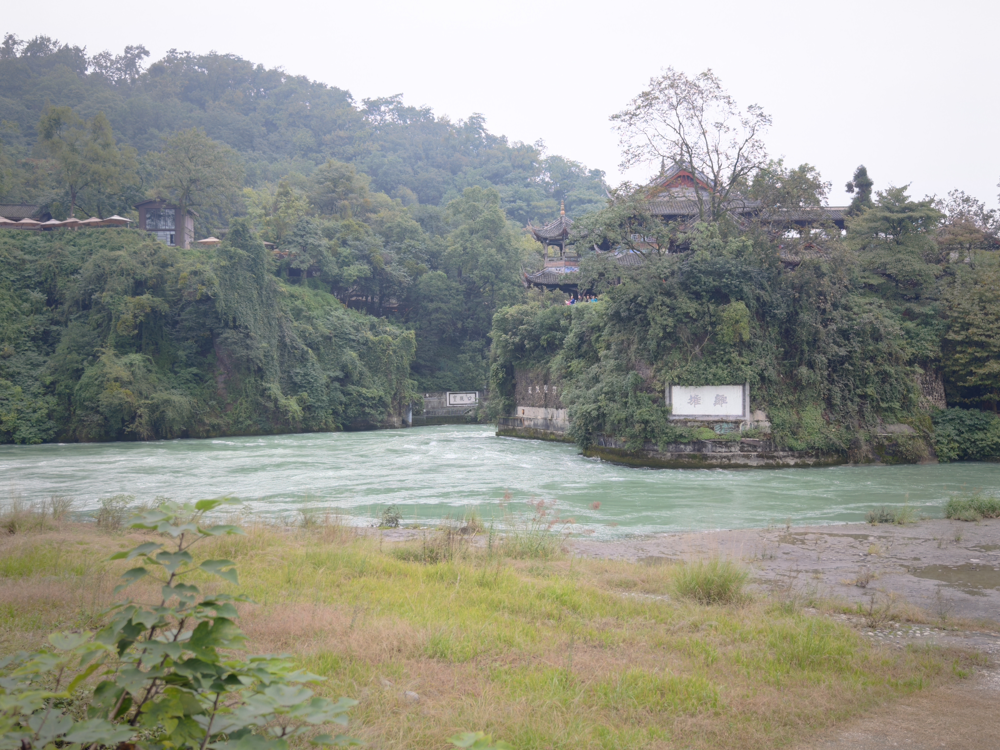
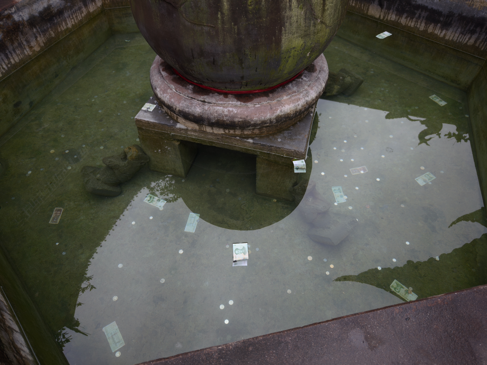
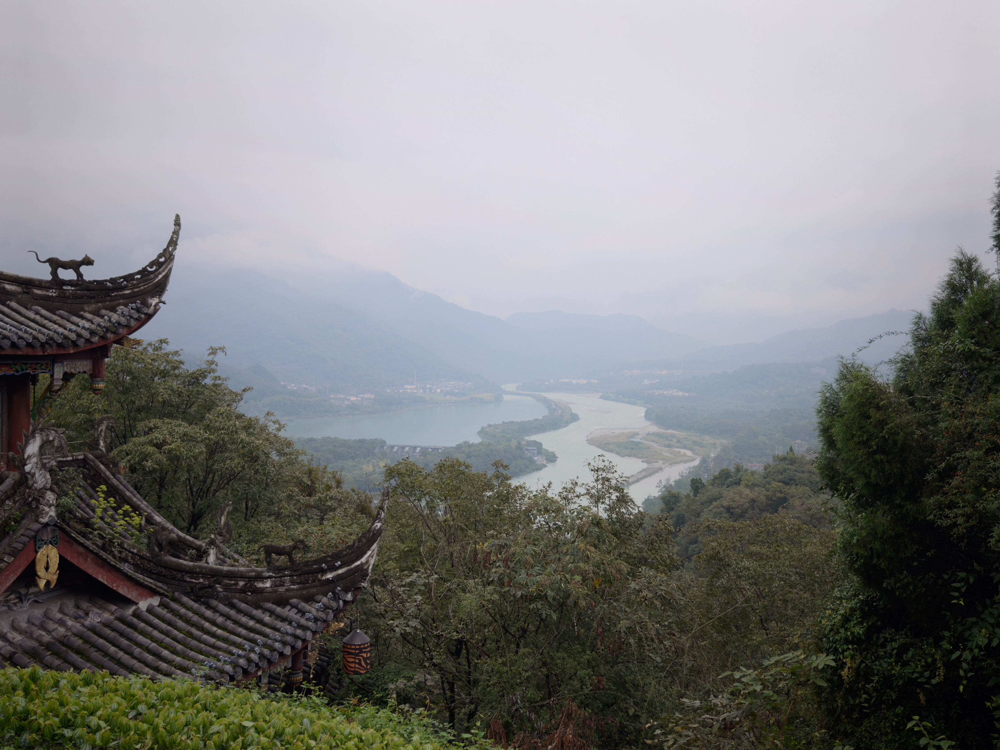
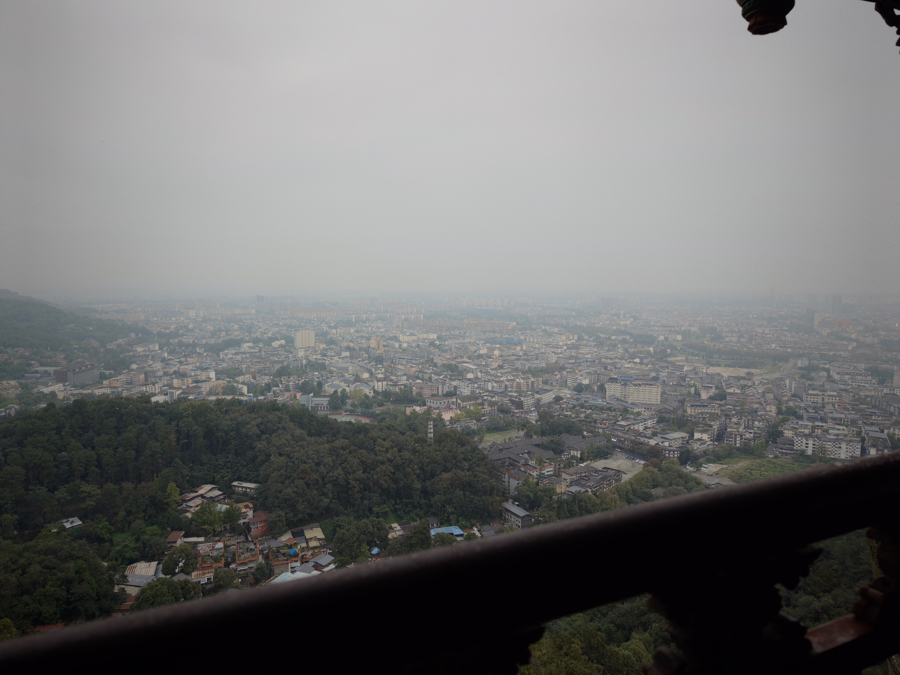
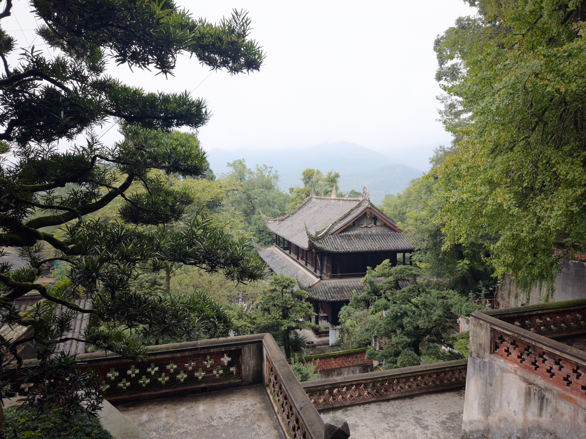
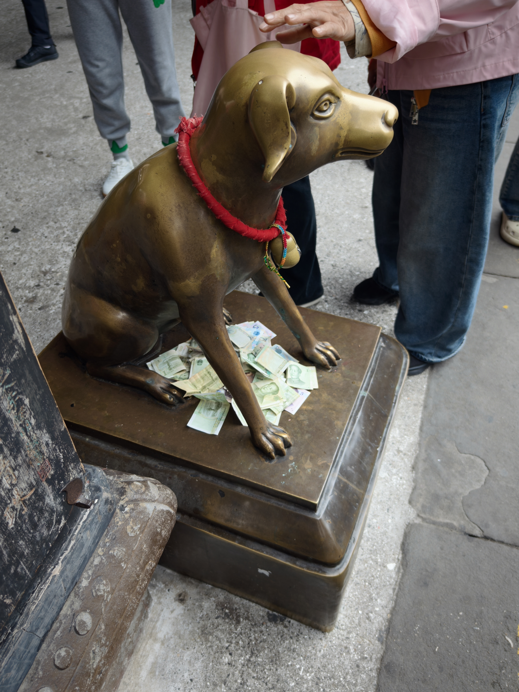
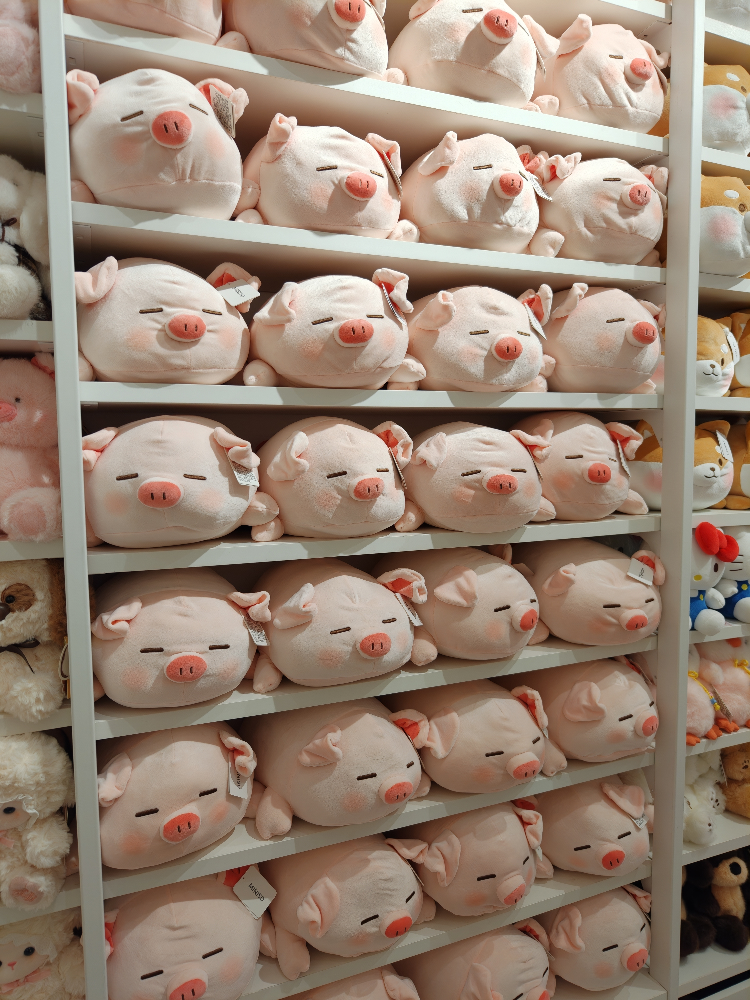
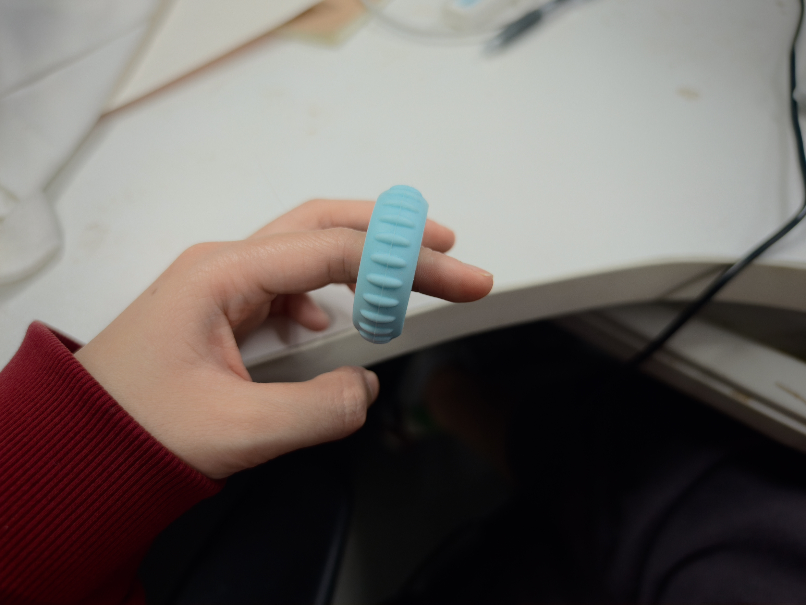

## 摘要

nju websoft图论组老年旅游团，5题，寄。

截截负责搞打星名额，Dew老师负责报名，我负责摸鱼。

成都非常大，不愧是周边几个省的公共省会，但我这次看到的成都和刻板印象里的成都有一定区别。

## Day -?

新规定，icpc打星也要在pintia上报名，操作很复杂。

本来想把“九乡河野生动物园”当学校名的，但误填成了队名。

## Day 0, 10.23 Fri

比赛是电子科大办的，但赛场在郫都区体育中心，离电子科大清水河校区约10km。

郫都区就是郫县，被成都吞并后改名。荒郊野岭，好在附近酒店便宜，dew订了亚朵x，还不错。

从酒店窗户能看到一个湖，湖上有五颜六色的游船。

附近酒店很多，旁边有个酒店门口摆了个牌子“欢迎参加icpc成都站的师生”。

虽然酒店门口就是有轨电车站，但地处偏远，且有轨电车需要等灯+路口减速，到电子科大旁边的商场需要40min。

打车去都江堰，都江堰是县级市，在四川盆地底部平原的最西端，也由成都代管。

枯水期，不算壮观。但江水是青白色的，我以前没见过这么清的江水。

有个池子，见过不少往池子里扔硬币的，头一次见往池子里扔纸币的。

 

山上景色更好一些，一边能俯瞰都江堰，一边能俯瞰都江堰市。都江堰市虽然是县级市，但一望无际，比伊春这个地级市大。

 

山上有个道观，是西游记的取景地之一，供奉二郎神和李冰。正殿供二郎神，门口哮天犬的头顶被摸得锃亮，肚皮下塞满了钱。偏殿供李冰，比较冷清。

 

最高峰叫玉垒山，山上有个玉垒楼。杜甫《登楼》有联“锦江春色来天地，玉垒浮云变古今”，不过这个楼是现代盖的，跟杜甫没什么关系。

晚上dew老师少儿编程讲课，我和截截去电子科大附近的商场吃醪糟+甜水面+宜宾燃面+凉拌猪头肉+烧卖，吃完饭又去miniso买了指环+笔+猪+海绵宝宝里的不高兴鱼挂件，然后第二天喜提窜稀。

 

## Day 1, 10.24 Sat

7:30起，酒店早餐，然后打车去成都博物馆。快到了的时候车被追尾，我正好去厕所。然后又打了一辆车去博物馆。

博物馆在成都的正中心，周边堵车严重。展品还可以，比较有代表性的是好几个惟妙惟肖的大笑陶俑，还有个意义不明的一边笑一边撅屁股的。

dew老师去找同学面基，截截听说成都的老妈蹄花好吃，开始我们以为老妈蹄花是个连锁店，结果出租车司机说成都有逝量的“某某老妈蹄花”，然后把我们带到了附近的他认为比较好吃的一家。事实证明司机说得对，后续我看到了几十家“某某老妈蹄花”“某某双流兔头”，前缀小得看不见，还都说自己是总店。

点了蹄花和酸菜鱼。服务员听不太懂普通话，截截问“有多辣”，重复了几遍，但服务员一直听成“有多大”。成都的服务人员默认使用成都话，所以截截负责和服务人员交流。

截截说蹄花在他老家是用来醒酒的。蹄花很清淡，我不太喜欢吃，酸菜鱼的酸菜味道很好，但鱼一般。

-----

物资是icpc帽衫+一个塑料熊猫+一个电子科大徽章，我觉得都挺丑的，扔了。

热身赛3道原+1道评测机压力题：没有输入，答案是0-100的整数。正解是写脚本交100次，评测机没炸。

晚上截截去电子科大找同学，白天dew老师说也想要指环，所以我又去附近商场的miniso给dew代购。本来想再买两个指环，三个人一人一个，结果指环良率感人，我买+换货经手了5个指环，只有一个能转动，给dew老师了。（回学校后我网购轴承，组装了一个好使的自己用）

截截和同学用四川话聊天，我来了之后切换到普通话。截截的同学带我和截截进了电子科大。校区很大，里面几个大湖，湖里有天鹅。

据说有校友捐赠了一些透明琴房，我觉得这个想法非常好，琴房一定要用来练琴，~~透明琴房可以有效避免琴房变成种群，南大发生过这种事~~。

晚上雾霾严重，电子科大和酒店都有雾霾。

## Day 2, 10.25 Sun

7:30起床，我顺走了亚朵的瓶装茶饮料，截截和dew外卖点瑞幸，一人一个超大杯。

酒店吃早餐，我喝了点**拿铁**咖啡，dew对酒店的担担面给予高度评价。

Dew老师在比赛开始前就喝完了超大杯瑞幸。截截怕上厕所，到比赛结束也没怎么喝咖啡 ~~，评价为不喝买它干啥~~。

老规矩，dew从前往后读题，截截从后往前，我看中间。dew看A觉得可做，我看E觉得可做，很快想到了取一个点对凸包三角剖分，但没想清楚如果点在剖分线上该怎么搞。

很快有人过M，截截写M，截截写了很久的M。截截写到一半时，我看榜发现D有人过，然后发现D是个好写的签到，写D，过。Dew老师认为A可做，一直在想A。

看榜发现K、C、I有人过。 ~~我看C后说这不是O(n^4)暴力可过，然后dew说T=10000且没限制n的和根本过不去，~~ 于是Dew去看C。I是个通信题，我一时没思路，就去看K，截截写完M以后，我把I甩锅给截截。我想了亿会以后会做K（太菜了，想了逝量错误贪心之后才想到只需要考虑最左端和最右端），写K，wa。我由于没用到坐标的单调条件，一度以为做法假了，最终发现只是把区间求交写出了智障bug，AC。

dew发现了C诈骗题的本质，dp看着像$O(n^3)$实际是$O(n^2)$，写，AC。

我继续想E，由于一直没人过A，dew放弃A去想有人通过的H（事后诸葛亮：A不难且比H好写很多）。我会E后和dew讨论了一下n=3 n=4的corner case，但此时截截正在写I。截截逝图使用bfs做I，但写不出来，和我讨论，我顺着截截的思路想到可以用dfs欧拉序直接$2n$，重构I，AC。

在我想/重构/调试I的过程中，Dew已经开始写H并和截截讨论。AC I后距比赛结束只剩约1h，dew认为不可能既通过H又通过E。于是我挂机~~实际上还在想E的实现，梦想总是要有的，万一见鬼了呢~~，dew和截截讨论H。截截试图给我讲H，但我听得云里雾里，根本挑不出bug。最后没有通过，dew在赛后又发现2个bug。

-----

由于太寄了所以没看滚榜就走了，下午居然出了太阳。

dew找同学面基走了。我和截截去电子科大附近的商场吃饭，点了回锅肉和麻婆豆腐，但味道一般。然后我和截截夜游春熙路+安顺廊桥+人民公园。

成都地铁驾驶室开放，一个人坐着开地铁，另一个人站在旁边监督。司机的椅子看起来不太舒服，头枕低于司机的脖子。地铁没有脚踩的油门刹车，也没有方向盘，只有一根杆，前推加速，后拉刹车。地铁时速约65km/h。

春熙路非常繁华，店铺众多，且档次较为亲民 ~~（没有针对你们的意思，南京新街口和上海环贸iapm）~~，非常适合逛街购物。但我只带了个小箱子来成都，购物不方便带走，所以简单看看就走了。

安顺廊桥在锦江上，附近是酒吧一条街。最靠近地铁站的是国窖的店，有个乐手拉小提琴，好听。其余的酒吧虽有驻唱，但大部分业余水平。

人民公园晚上黑灯瞎火，无人贩卖机还会说话，很吓人，看了保路运动纪念碑就走了。

## Day 3, 10.26 Mon

上午去了三星堆，有个陶猪很像愤怒的小鸟里的猪。

下午又去人民公园，市中心堵车依旧，公园里人山人海，有几个老年乐队，水平出乎意料的不错。

公园里的吃的又贵又没特色又卖完了，茶位也全满。搞的菊花展还不错，有一个摊位专门用来展览市民养的菊花。

晚上截截带我吃永乐饭店，点了鸡丝凉面+麻婆豆腐+回锅肉+鱼+油渣莲白+唯怡豆奶。截截对鸡丝凉面和油渣莲白给予高度评价，认为麻婆豆腐和回锅肉正宗但味道一般。

饭店在武侯区，附近就是居民区和菜市场，还有大片的步行街，非常有生活气息，符合成都松弛的刻板印象。

附近赫鲁晓夫楼的阳台都是统一的深蓝色透明雨棚。有一些带藏文的店面，还有个成都西藏小学，修得很气派。

---

我和截截打车去天府机场。我平时习惯把价格拉到较低位置，但取消勾选特惠快车，但这次我只下拉了价格，但忘取消特惠快车了。

第一辆车的司机取消了订单。

第二辆车到达，我们把行李搬进后备箱，上车后司机说不走平台付款，否则拒载，我们没见过这种情况，下车并搬下行李。

第三辆车到达时，我发现我的书包落在第二辆车后备箱里了，紧急取消第三辆车订单。

由于第二辆车订单被取消，高德界面上没有第二辆车司机的联系方式。我尝试使用高德软件里的客服对话框，但ai且没有转人工选项。

截截使用gpt搜索到高德的客服电话，可以打通且有人工客服，客服说帮我联系司机。

考虑到包里没有证件，可以邮寄，我们打算照常返程。截截又叫车去机场，一上车司机就要30元返空费，此时时间已经很紧张，不得不同意。

司机说有的平台强制派单，由于我们坐的是当天最后一班飞机，去机场之后返程接不到人会亏钱，所以我们打到的车都拒载或想多收钱。

去机场的途中高德客服来电说联系上了司机，给了司机150r感谢费，让司机把包寄到学校。

回到南京之后发现成都作为一个巨型城市，打车费居然要比南京便宜不少，看来成都司机要钱有一定道理。

## 感想

在哈尔滨的时候苦于雾霾和堵车，没想到成都也有雾霾和堵车，并且周一下午非晚高峰时段市中心也会堵车，不知道是不是游客多的原因。

成都是我见过唯一的服务业默认使用当地方言的省会城市。以前我还去过上海和广州，但服务人员都默认说普通话，可能是因为服务人员也是外地人。

遗憾没吃到特别好吃的，也没看到熊猫，明年成都站再说。